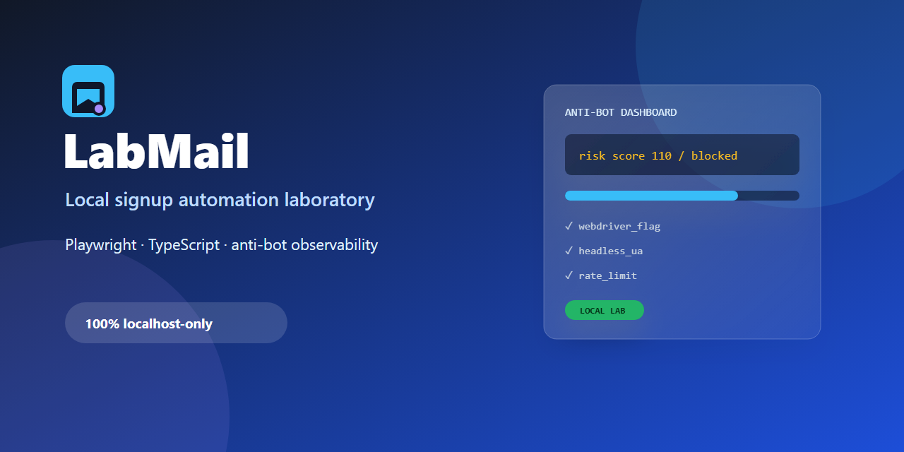

# LabMail



> Laboratorium lokal untuk mempelajari otomasi browser dan observability anti-bot — aman, reproducible, dan tidak menyentuh Google.

[](https://nodejs.org/)
[](https://playwright.dev/)
[](https://www.typescriptlang.org/)
[](#batas-keamanan)

## Ringkasan

LabMail meniru alur signup multi-langkah dengan domain lokal `@labmail.test`.
Kamu dapat membandingkan bot yang mengisi form secara instan dengan simulasi input
bertahap, lalu melihat alasan detector memblokir percobaan tersebut.

**Ini bukan Gmail, tidak membuat akun Google, tidak mengirim SMS, dan tidak menghubungi Google.**

## Menjalankan

```sh
npm install
npx playwright install chromium
npm run server
```

Buka:
- http://127.0.0.1:3000 — pendaftaran manual: nama → tanggal lahir → username → password/nomor → kode
- http://127.0.0.1:3000/inbox — inbox SMS simulasi untuk mengambil kode
- http://127.0.0.1:3000/admin — dashboard percobaan dan alasan pemblokiran; refresh untuk melihat perubahan

Di terminal kedua:

```sh
npm run bot                      # mode naive: headless, mengisi langsung
npm run bot -- --human            # browser terlihat, event keyboard dan pointer + jeda
npm run bot -- --human --count 4  # demonstrasi rate limit setelah tiga akun
npm run typecheck
```

Bot hanya menerima origin `http://127.0.0.1` dan memblokir request ke origin lain,
termasuk redirect. `LAB_URL` bisa mengubah port lokal. Count dibatasi 1–20;
kegagalan teknis dilaporkan dengan exit code 1, pemblokiran detector adalah hasil eksperimen normal.
Mode human adalah **simulasi input di lab**, bukan bukti bahwa bot lolos deteksi Google.
Tidak ada patch webdriver, proxy, layanan nomor virtual, atau CAPTCHA solver.

## Eksperimen

1. Jalankan naive: biasanya diblokir pada langkah nama.
2. Jalankan human: masih mencatat `webdriver_flag`, tetapi sinyal itu saja belum mencapai threshold.
3. Setelah tiga akun dari IP yang sama, percobaan berikutnya diblokir oleh `ip_rate_limit`.
4. Isi field honeypot `website` lewat DevTools pada form: detector memberi 100 poin.
5. Bandingkan signal dan score di dashboard. Setiap rule dihitung sekali per attempt,
   bukan sekali per field/halaman. Threshold kumulatif: 70.

Rule: webdriver (40), User-Agent headless (40), dwell <1.5 detik (20), tanpa pointer
(15), isi tanpa keydown (30), typing <30 ms/key (25), tanpa telemetry (60), honeypot
(100), rate limit (100). Heuristik ini sengaja sederhana dan bisa false-positive;
pengguna keyboard-only/paste tidak otomatis berarti bot. Telemetry berasal dari klien,
jadi tidak bisa dipercaya sebagai kontrol keamanan tunggal.

Konfigurasi server: `PORT` (3000), `RATE_LIMIT` (3), `RATE_WINDOW_MIN` (10).
Server hanya bind ke 127.0.0.1. Data disimpan di `data/db.json`; tombol Reset menghapus
akun, SMS, dan log lokal. Draft sesi tidak dipersist sehingga restart memerlukan
pendaftaran baru melalui `/`.

## Struktur

- `src/server/index.ts`: HTTP server dan state machine pendaftaran
- `src/server/detector.ts`: penilaian risiko
- `src/server/views.ts`: form, telemetry browser, inbox, dashboard
- `src/server/store.ts`: penyimpanan JSON
- `src/bot/pages.ts`: objek langkah pendaftaran
- `src/bot/actors.ts`: strategi input naive/human
- `src/bot/index.ts`: runner, batas localhost, pembacaan SMS simulasi
- `src/bot/persona.ts`: identitas dan nomor fiktif

## Batas keamanan

Ini lab, bukan sistem produksi: inbox dan dashboard tanpa autentikasi, SMS/code
tersimpan lokal, password memakai SHA-256 tanpa salt dan **tidak layak untuk password
produksi**. Jangan masukkan password/nomor pribadi, expose server ke internet, atau
memakai data lab sebagai kredensial nyata. Untuk produksi diperlukan password KDF,
autentikasi admin, CSRF protection, validasi lebih ketat, dan penyimpanan transaksional.
